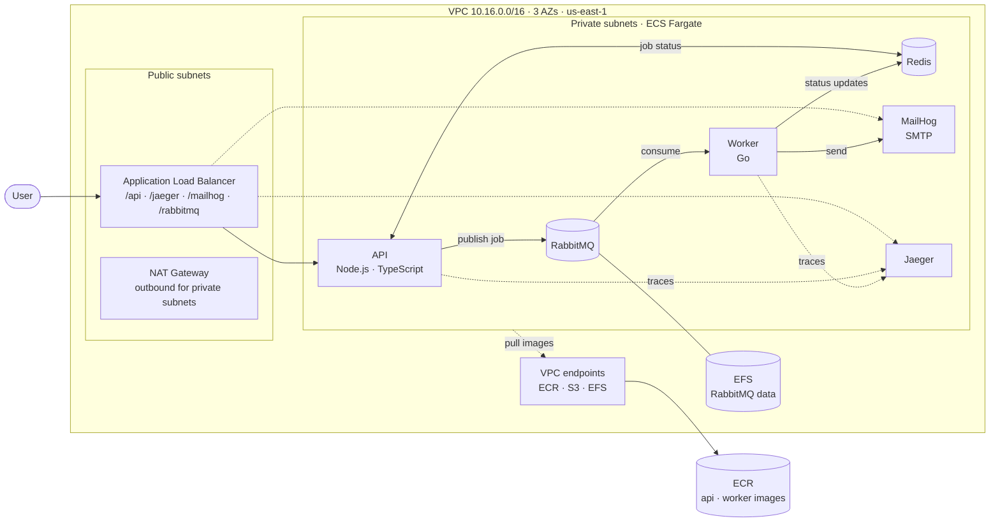
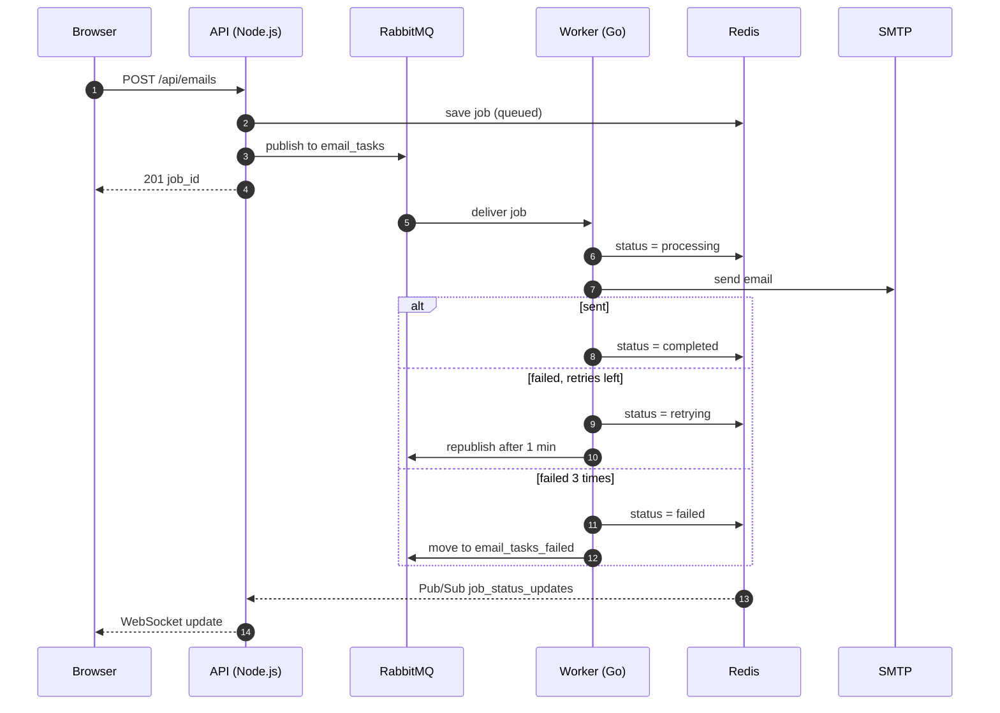

# Mail Sender

An asynchronous email pipeline on **AWS ECS Fargate**: a Node.js API accepts email jobs and queues them in RabbitMQ, a Go worker sends them, and job status streams back to the browser over WebSockets. Everything runs in a multi-tier VPC, provisioned with **Terraform**.

**[Video walkthrough](https://www.loom.com/share/f9ab6f55084540c5a0ad010af3fbef89)**

## What this project demonstrates

- **Async processing with a message broker:** the API responds immediately with a job ID; the worker processes jobs at its own pace and can be scaled horizontally.
- **Retries and a failed-jobs queue:** a failed send is retried after 1 minute, up to 3 times, then moved to `email_tasks_failed`.
- **Real-time status:** the worker publishes status changes to Redis Pub/Sub; the API relays them to the browser over WebSockets.
- **Network design on AWS:** 3 AZs, public / private / isolated subnet tiers, ALB with path-based routing, NAT Gateway, VPC endpoints for ECR, S3 and EFS, and private DNS through Cloud Map.
- **Infrastructure as code:** one Terraform module per concern (VPC, ALB, ECS cluster, ECR, one module per service).
- **Distributed tracing:** OpenTelemetry in both services, so one trace follows a job from API to worker in Jaeger.
- **Clean layering in both services:** use cases depend on interfaces (broker, cache, SMTP), so RabbitMQ can be swapped for SQS in the API.

## AWS architecture



Services find each other by private DNS (`rabbitmq.task-manager.local`, `redis.task-manager.local`, ...) through AWS Cloud Map.

## Job lifecycle



## Tech stack

**API:** Node.js, TypeScript, Express, WebSockets, Zod
**Worker:** Go, OpenTelemetry
**Messaging & state:** RabbitMQ (SQS adapter available), Redis
**AWS:** ECS Fargate, ECR, ALB, VPC, NAT Gateway, EFS, Cloud Map, CloudWatch Logs
**Tooling:** Terraform, Docker Compose, Jaeger, MailHog

## Run it locally

```sh
make up        # docker compose: API, worker, RabbitMQ, Redis, MailHog, Jaeger
```

| URL | What |
|---|---|
| http://localhost:3000 | Web UI to send emails and watch their status |
| http://localhost:8025 | MailHog, the inbox where sent emails land |
| http://localhost:16686 | Jaeger traces |
| http://localhost:15672 | RabbitMQ management (`admin` / `password`) |

Or from the terminal:

```sh
curl -X POST http://localhost:3000/api/emails \
  -H "Content-Type: application/json" \
  -d '{"to":"test@example.com","subject":"Hi","body":"Hello"}'

curl http://localhost:3000/api/jobs/history
```

To see retries, send to `error-1@email.com` (fails once, then succeeds) or `error@email.com` (always fails and ends in the failed queue).

## Deploy to AWS

```sh
make deploy      # push images to ECR, terraform apply, roll out the ECS services
make tf-destroy  # tear everything down
```

## Trade-offs

This is a learning project, so some choices favor showing the pieces over production cost:
- RabbitMQ, Redis and Jaeger run as Fargate tasks instead of Amazon MQ, ElastiCache and X-Ray.
- MailHog stands in for a real SMTP provider such as SES.
- A single NAT Gateway keeps cost down at the price of an AZ-level single point of failure.
